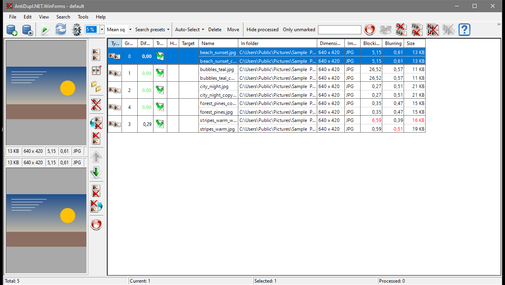

# AntiDuplPlus

[](https://github.com/Sucotasch/AntiDuplPlus/actions/workflows/AntiDupl_CI.yml)
[](LICENSE)


[English](README.md) · **Русский**

AntiDuplPlus находит дубликаты и похожие изображения в больших коллекциях фотографий.
Приложение один раз строит базу с индексом ваших картинок, сравнивает каждое изображение
с каждым другим на видеокарте NVIDIA и показывает совпадения парами с оценкой похожести —
решение, что оставить, всегда за вами. Это форк [AntiDupl.NET](https://github.com/ermig1979/AntiDupl)
с GPU-конвейером (декодирование nvJPEG, сравнение на CUDA) и поддержкой нескольких баз
данных.



*Результаты поиска для небольшой демонстрационной библиотеки: каждая строка — пара
изображений с оценкой похожести и превью обоих файлов.*

## Содержание

- [Что делает приложение](#что-делает-приложение)
- [Возможности](#возможности)
- [Требования](#требования)
- [Установка](#установка)
- [Быстрый старт](#быстрый-старт)
- [Как это работает](#как-это-работает)
- [Базы данных](#базы-данных)
- [Пресеты поиска и алгоритмы](#пресеты-поиска-и-алгоритмы)
- [Работа с результатами](#работа-с-результатами)
- [Поддерживаемые форматы](#поддерживаемые-форматы)
- [Командная строка](#командная-строка)
- [Файлы и настройки](#файлы-и-настройки)
- [Горячие клавиши](#горячие-клавиши)
- [Если что-то не работает](#если-что-то-не-работает)
- [Сборка из исходного кода](#сборка-из-исходного-кода)
- [Отличия от оригинального AntiDupl.NET](#отличия-от-оригинального-antiduplnet)
- [Ограничения](#ограничения)
- [Лицензия](#лицензия)
- [Благодарности](#благодарности)

## Что делает приложение

Фотобиблиотеки растут: копии одной и той же картинки оказываются в разных папках,
скриншоты пересохраняются, изображения уменьшают для отправки, а серийная съёмка даёт
несколько почти одинаковых кадров. Вручную разбирать это дольше, чем несколько тысяч
файлов.

AntiDuplPlus ищет совпадения четырёх видов:

- **точные копии** — одно и то же изображение, сохранённое дважды;
- **пересжатые и уменьшенные копии** — та же картинка с другим качеством JPEG или в
  другом размере;
- **преобразованные копии** — повёрнутые или отражённые версии изображения;
- **похожие изображения** — разные кадры одной сцены (серийная съёмка, варианты,
  обработка).

Совпадения показываются парами: оценка похожести и превью обоих файлов. Без вашей
команды приложение ничего не удаляет, не перемещает и не переименовывает, а удаление
по умолчанию отправляет файлы в Корзину (либо в выбранную вами папку).

Приложение рассчитано на большие библиотеки: индекс изображений строится один раз и
затем переиспользуется, поэтому повторные поиски не читают ваши файлы заново.

## Возможности

**Поиск**

- Три алгоритма сравнения: *Squared Sum* (быстрый), *SSIM* (точнее совпадает с
  человеческим восприятием) и *Perceptual hash* (256-битный DCT-хэш для очень быстрого
  прохода по почти-дубликатам; допуск задаётся в процентах, по умолчанию 33 %).
- Регулируемый допуск в панели инструментов.
- Пять **пресетов поиска** в один клик: *Точные копии*, *Сжатие и изменение размера*,
  *Преобразования*, *Похожие: строго*, *Похожие: шире*.
- Дополнительные ограничения: сравнивать изображения только внутри одной папки или
  одного пути поиска, контроль размера, контроль типа файла, контроль пропорций,
  минимальный и максимальный размер изображения.
- Одновременное сравнение нескольких баз данных, в том числе *Pool 1 против Pool 2*
  (см. [Базы данных](#базы-данных)).

**Базы данных**

- Любое количество независимых баз, каждая строится по одной исходной папке.
- Базу создаёт и обновляет GPU-коллектор: он сохраняет маленькие превью, метаданные
  файлов и метрики качества изображений — именно это делает поиск быстрым.
- Инкрементальное обновление существующей базы; смена исходной папки базы без её
  пересборки (перепривязка).

**Результаты**

- Таблица результатов с превью, путями, размерами файлов и похожестью; колонка
  *Target* показывает, к какому изображению пары относится действие.
- Удаление первого / второго / обоих изображений, замена одного изображения другим,
  переименование — по одному или пакетно, из панели инструментов, контекстного меню или
  окна предпросмотра.
- **Автовыбор** отмечает изображение, которое нужно оставить, в каждой паре: быстрые
  критерии (старше, новее, меньше …) или расширенная комбинация критериев (разрешение,
  размер, дата, качество, пул), вычисляемая по логике И.
- **Оставить только это** помечает остальные изображения группы как худшие, ничего не
  удаляя.
- **Метки «обработано»**: скрывайте уже просмотренные пары, видьте их количество в
  строке состояния и отмечайте пары автоматически после пакетных операций. Метки
  хранятся в `user\processed.tsv`.
- Фильтры: скрыть обработанные пары, показать только неотмеченные, фильтр по тексту пути.
- Пути **«Не удалять»**: защищённый список, который пропускают пакетные операции и
  автовыбор, с предупреждением о том, сколько файлов было пропущено.
- **Поиск дефектов**: блочность и размытость измеряются при построении базы, поэтому
  смазанные и пересжатые картинки можно найти и удалить отдельно.

**Производительность и интерфейс**

- JPEG декодируется на видеокарте (nvJPEG), все сравнения выполняются CUDA-ядрами.
- Размер превью 32×32 / 64×64 / 128×128. Чем меньше превью, тем больше изображений
  помещается в один поиск: примерно 6 млн при 32×32 и 8 ГБ видеопамяти, 1,6 млн при
  64×64 и 0,4 млн при 128×128, пропорционально больше при большем объёме; окно *Options*
  показывает оценки.
- Семь языков интерфейса: английский, русский, французский, немецкий, греческий,
  китайский (упрощённый), испанский.

## Требования

**Для работы**

- Windows 10 или 11, 64-битная.
- Видеокарта NVIDIA **поколения Turing или новее** (GTX 16xx, RTX 20xx и далее).
  Сравнение выполняется только на GPU — в этом форке нет запасного пути на CPU, — а
  построитель баз декодирует JPEG через nvJPEG.
- Актуальный драйвер NVIDIA. Библиотеки CUDA входят в состав приложения, устанавливать
  CUDA Toolkit не нужно.
- **.NET 8 Desktop Runtime** — только для zip-пакета и самораспаковывающегося exe (ссылка
  в разделе [Установка](#установка)). Однофайловой портативной сборке он не нужен.
- Свободное место на диске для баз данных: они хранятся рядом с приложением.

**Для сборки** — см. [Сборка из исходного кода](#сборка-из-исходного-кода).

## Установка

В каждом релизе четыре файла (плюс контрольные суммы SHA-256 в `*.hash.txt`):

| Файл | Что внутри | Нужен .NET 8 |
|---|---|---|
| `AntiDupl.NET-<версия>.zip` | Полное приложение: интерфейс, `AntiDupl.dll`, построитель баз `NvJpegCollector.exe`, библиотеки CUDA, ресурсы | да |
| `AntiDupl.NET-<версия>.exe` | Тот же пакет в виде самораспаковывающегося архива | да |
| `AntiDupl.NET-<версия>_SingleFilePortable.exe` | Один самодостаточный исполняемый файл интерфейса — **без** построителя баз | нет |
| `AntiDupl.NET-<версия>_SingleFilePortable.zip` | Тот же портативный файл в zip-архиве | нет |

**Используйте zip-пакет.** Только он умеет создавать и обновлять базы данных.
Портативная сборка предназначена для машин, где нельзя установить .NET, и для
пользователей, у которых базы уже построены полным пакетом.

Порядок установки:

1. Скачайте релиз со [страницы релизов](https://github.com/Sucotasch/AntiDuplPlus/releases).
2. Распакуйте zip в папку, в которую у вас есть запись (приложение хранит базы,
   настройки и журналы внутри своей папки — не размещайте его в `Program Files`).
3. Если приложение не запускается, установите
   [.NET 8 Desktop Runtime](https://dotnet.microsoft.com/download/dotnet/8.0).
4. Запустите `AntiDupl.NET.WinForms.exe`.

Ничего не устанавливается в систему: приложение работает из своей папки. В реестр
текущего пользователя попадают только несколько настроек интерфейса (раскладка окна,
режим сравнения пулов).

## Быстрый старт

1. **Создайте базу.** Нажмите **New Database** в панели инструментов (или *Tools → New
   Database*), выберите папку с изображениями и дождитесь окончания работы коллектора.
   База появится в `databases\<имя>\`.
2. **Проверьте базу.** Откройте **Database Manager** и убедитесь, что новая база
   включена (**On**). Если нужно сравнить две библиотеки между собой, назначьте их
   *Pool 1* и *Pool 2* и выберите режим сравнения.
3. **Запустите поиск.** Нажмите **Search**. GPU сравнит все проиндексированные
   изображения друг с другом, и пары появятся в таблице результатов.
4. **Разберите результаты.** Пользуйтесь **пресетами поиска**, чтобы менять определение
   дубликата, **автовыбором**, чтобы отметить копии к удалению, *Оставить только это*,
   чтобы пометить целую группу, и **Mark as Processed** для уже просмотренных пар.
5. **Уберите лишнее.** Удалите отмеченные файлы в **Корзину** или переместите их в
   отдельную папку, а когда библиотека изменится — обновите или пересоберите базу.

## Как это работает

```
исходная папка ──► NvJpegCollector (GPU) ──► база: превью + метаданные + качество
                                                   │
                                        поиск (CUDA): каждое изображение с каждым
                                                   │
                                        таблица результатов: пары + похожесть
```

- **Индексация.** Коллектор обходит исходную папку, декодирует каждое изображение (JPEG
  на GPU, остальные форматы на CPU), уменьшает его до превью (по умолчанию 32×32,
  настраивается от 16 до 128), измеряет блочность и размытость и записывает записи в
  `databases\<имя>\`.
- **Поиск.** Движок загружает включённые базы, держит превью в памяти видеокарты и
  сравнивает каждое изображение с каждым другим. Во время поиска ваши исходные файлы не
  читаются — поэтому повторные поиски быстрые.
- **Обнаружение изменений.** Запись считается актуальной, пока совпадают путь, размер и
  время изменения файла; обновление добавляет новые файлы, обновляет изменённые и
  убирает пропавшие.
- **Похожесть** вычисляется по превью, то есть является оценкой по своей природе;
  допуск (или пресет) определяет, насколько близкими должны быть два изображения, чтобы
  попасть в результаты.

## Базы данных

База данных — это компактный индекс одной исходной папки:

- `databases\<имя>\index.adi` — индекс;
- `databases\<имя>\0000.adi` — превью, метаданные файлов и метрики качества;
- `ad_database.xml` рядом с исполняемым файлом — список известных баз, их исходных папок,
  пулов и состояния включения.

**Database Manager** (кнопка в панели инструментов или *Tools → Database Manager*)
позволяет:

- включать и выключать базы (**On/Off**) для следующего поиска;
- назначать базы на **Pool 1** и **Pool 2** и выбирать, что сравнивается:

  | Режим сравнения пулов | Что сравнивается |
  |---|---|
  | None | сравнение пулов выключено |
  | Pool 1 internal | изображения пула 1 между собой |
  | Pool 2 internal | изображения пула 2 между собой |
  | Cross | пул 1 против пула 2 |
  | All | оба пула между собой и друг с другом |

- **Update** — обновить базу после добавления, изменения или удаления файлов
  (инкрементально: обрабатываются только различия);
- **Path…** — указать новую исходную папку после переноса или переименования папки.
  Превью остаются годными, пересборка не нужна; колонка *Moved* показывает `yes`, пока
  сохранённые пути отличаются от настроенной папки. Нажмите **Update**, чтобы переписать
  сохранённые пути.

Базы могут быть большими: держите их на быстром локальном диске и помните, что число
изображений, сравниваемых за один поиск, ограничено видеопамятью (оценки ёмкости есть в
окне *Options*).

## Пресеты поиска и алгоритмы

В панели инструментов есть выбор алгоритма, поле допуска и выпадающий список **Search
presets**, который настраивает и то и другое одним кликом:

| Пресет | Что находит |
|---|---|
| Exact copies | изображения с одинаковым содержимым |
| Compression and resize | ту же картинку, пересжатую с другим качеством или уменьшенную |
| Transformations | повёрнутые и отражённые копии одного изображения |
| Similar: strict | визуально похожие кадры при строгом допуске |
| Similar: wider | визуально похожие кадры при более свободном допуске |

Алгоритмы, на которых они основаны:

- **Squared Sum** — попиксельная разница превью; самый быстрый режим, хорошо подходит для
  точных и почти точных копий.
- **SSIM** — структурное сходство; медленнее, но лучше согласуется с человеческим
  восприятием, поэтому это лучший выбор для похожих кадров.
- **Perceptual hash** — сравнение 256-битных хэшей; очень быстро, хорошо находит
  пересжатые и слегка изменённые копии. Допуск задаётся в процентах (по умолчанию 33 %).

После выбора пресета алгоритм и допуск можно скорректировать вручную.

## Работа с результатами

Каждая строка показывает пару изображений: превью, пути, размеры и оценку похожести.
Колонка **Target** отмечает изображение пары, к которому применяются действия; щёлкните
по ней, чтобы переключиться между первым и вторым изображением.

- **Удаление** первого, второго или обоих изображений — по умолчанию в Корзину (это
  можно изменить в *Options*) либо перемещение в выбранную папку.
- **Замена** одного изображения другим или **переименование** одного по образцу другого
  без изменения содержимого.
- **Автовыбор** отмечает копии к удалению по быстрым критериям (старше, новее, меньше …)
  или по расширенному правилу из нескольких критериев с логикой И.
- **Оставить только это** помечает все остальные изображения группы как худшие.
- **Mark as Processed** скрывает пару, не трогая файлы; **Unmark Processed** и **Clear
  Processed Marks** отменяют это. С опцией *Mark Processed After Operations* пары
  отмечаются автоматически после пакетного действия.
- **Фильтры** скрывают обработанные пары, показывают только неотмеченные или
  фильтруют по фрагменту пути; строка состояния показывает, сколько пар обработано и
  сколько показано сейчас.
- **«Не удалять»** (*Search → Paths*) защищает папки: пакетные операции и автовыбор
  пропускают эти файлы и сообщают, сколько было пропущено.
- **Показать соседей** (Ctrl+Q) выводит все изображения, похожие на выбранное, а не
  только пару, в которую оно входит.

> В приложении нет отмены удалений и перемещений: удалённые файлы попадают в Корзину (или
> в целевую папку), поэтому восстанавливайте их оттуда или через Проводник. **Ctrl+U**
> только снимает разметку автовыбора; файлы он не возвращает.

## Поддерживаемые форматы

Построитель баз индексирует следующие форматы:

| Формат | Расширения | Декодирование |
|---|---|---|
| JPEG | `.jpg` `.jpeg` `.jpe` `.jif` `.jfi` `.jfif` | GPU (nvJPEG) |
| PNG | `.png` | CPU (Windows Imaging Component) |
| BMP | `.bmp` `.dib` | CPU (Windows Imaging Component) |
| GIF | `.gif` | CPU (Windows Imaging Component) |
| TIFF | `.tif` `.tiff` | CPU (Windows Imaging Component) |
| WebP | `.webp` | CPU (libwebp) |

Ядро работы с изображениями дополнительно декодирует AVIF, HEIF, JPEG XL, JPEG 2000,
PSD, TGA, DDS, ICO и EMF/WMF, но построитель баз пока не индексирует эти форматы,
поэтому в поиске они не участвуют.

## Командная строка

Построитель баз можно запускать отдельно — интерфейс запускает его с теми же опциями:

```bat
NvJpegCollector.exe --input "D:\Фото"
NvJpegCollector.exe --input "D:\Фото" --name "MyPhotos" --size 64
NvJpegCollector.exe --input "D:\Фото" --update
```

| Опция | Значение |
|---|---|
| `--input`, `-i` | Исходная папка с изображениями (обязательна) |
| `--output`, `-o` | Корневая папка баз (по умолчанию `databases` рядом с исполняемым файлом) |
| `--name`, `-n` | Имя базы (по умолчанию — имя исходной папки) |
| `--size`, `-s` | Размер превью в пикселях, 16–128 (по умолчанию 32) |
| `--workers`, `-w` | Число рабочих потоков CPU (по умолчанию определяется автоматически) |
| `--update`, `-u` | Инкрементальное обновление существующей базы |
| `--force-empty` | Разрешить очистку базы, если исходная папка пуста или недоступна |
| `--no-pause` | Не ждать нажатия клавиши в конце (для скриптов) |
| `--help`, `-h` | Показать справку |

Запускайте коллектор из папки приложения, чтобы база попала в папку `databases\`,
которую читает интерфейс.

## Файлы и настройки

Всё хранится рядом с исполняемым файлом, поэтому папку приложения можно целиком
перемещать или копировать:

| Путь | Содержимое |
|---|---|
| `databases\<имя>\` | Базы данных (`index.adi`, `0000.adi`) |
| `ad_database.xml` | Зарегистрированные базы, их исходные папки, пулы и состояние |
| `user\options.xml` | Настройки приложения |
| `user\processed.tsv` | Метки «обработано» |
| `user\mistakes.adm` | Запомненные пары-«ошибки» |
| `user\profiles\default.xml` | Профиль поискового движка по умолчанию |
| `trace.log`, `gpu_debug.log` | Диагностические журналы (создаются, только когда движок их пишет) |

## Горячие клавиши

Клавиши по умолчанию (все можно изменить в *View → Hot Keys*):

| Клавиша | Действие |
|---|---|
| NumPad 1 | Удалить первое изображение пары (или изображение с дефектом) |
| NumPad 2 | Удалить второе изображение |
| NumPad 3 | Удалить оба изображения |
| NumPad 4 | Заменить второе изображение первым |
| NumPad 6 | Заменить первое изображение вторым |
| NumPad 5 | Запомнить пару как ошибку |
| Ctrl+Q | Показать всех соседей выбранного изображения |
| Ctrl+U | Снять разметку автовыбора |

## Если что-то не работает

**Поиск ничего не находит**

- Проверьте, что база включена (**On**) в *Database Manager* и не пуста.
- Если исходная папка перемещена, колонка *Moved* показывает `yes` — укажите новую папку
  через **Path…** или выполните **Update**.
- Проверьте фильтры результатов: обработанные пары могут быть скрыты, а фильтр по пути —
  активен.

**Приложение сообщает, что GPU недоступен, или поиск завершается ошибкой**

- Обновите драйвер NVIDIA.
- Видеокарта должна быть поколения Turing или новее (GTX 16xx / RTX 20xx и выше); в этом
  форке нет запасного пути на CPU.
- Подробности ищите в `gpu_debug.log` рядом с исполняемым файлом.

**Приложение не запускается**

- Zip-пакету нужен [.NET 8 Desktop Runtime](https://dotnet.microsoft.com/download/dotnet/8.0);
  однофайловой портативной сборке — нет.

**Поиск очень долгий или не хватает видеопамяти**

- Уменьшите размер превью в *Options* (32×32 позволяет самые большие базы) или разделите
  библиотеку на несколько баз.

**Я случайно удалил файл**

- Восстановите его из Корзины или из папки, куда он был перемещён; в самом приложении
  отмены нет.

## Сборка из исходного кода

Что нужно:

- Visual Studio 2022 с компонентами *.NET Desktop development* и *Desktop development with
  C++*;
- CUDA Toolkit 12.8 (для `cudart64_12.dll` и правил сборки CUDA) и 13.1 (для
  `nvjpeg64_13.dll`, который использует коллектор);
- vcpkg с триплетом `x64-windows-static` (зависимости перечислены в `src/vcpkg.json`);
- .NET 8 SDK.

```bat
git clone https://github.com/Sucotasch/AntiDuplPlus.git
cd AntiDuplPlus
cmd\Deploy.cmd
```

`Deploy.cmd` собирает C++-проекты и интерфейс WinForms, копирует библиотеки CUDA и
ресурсы в `bin\Release\` и проверяет результат. Запускайте приложение из
`bin\Release\AntiDupl.NET.WinForms.exe` — это единственная папка, откуда интерфейс
работает, потому что он ищет `NvJpegCollector.exe` и `databases\` рядом с собой.

Другие полезные команды:

```bat
:: всё решение
msbuild src\AntiDupl.sln /p:Configuration=Release /p:Platform=x64

:: контрактные тесты (код возврата 0 = успех)
dotnet run --project tests\AntiDupl.Contract.Tests\AntiDupl.Contract.Tests.csproj
```

Инженерные заметки (тонкости сборки, форматы баз, CI) — в [AGENTS.md](AGENTS.md).

## Отличия от оригинального AntiDupl.NET

| Область | Оригинальный AntiDupl.NET | AntiDuplPlus |
|---|---|---|
| Декодирование JPEG | CPU (libjpeg-turbo) | GPU (nvJPEG) |
| Сравнение | CPU | CUDA-ядра (Squared Sum, SSIM, перцептивный хэш) |
| Базы данных | одна встроенная база | любое количество баз, создаваемых GPU-коллектором |
| Сравнение пулов | — | Pool 1 против Pool 2, пять режимов |
| Перенос исходной папки | пересборка | перепривязка базы к новой папке |
| Пресеты поиска | — | пять пресетов в один клик |
| Метки «обработано», защищённые пути | — | хранятся в `user\processed.tsv` и в настройках |
| Undo/Redo в интерфейсе | да | нет — восстанавливайте файлы из Корзины; Ctrl+U снимает разметку автовыбора |

## Ограничения

- **Только Windows x64.** Сборок для Linux и ARM нет.
- **Нужна видеокарта NVIDIA.** У сравнения нет запасного пути на CPU; без GPU класса
  Turing (или новее) поиск не выполняется.
- **Однофайловая портативная сборка не умеет создавать базы** — она поставляется без
  коллектора.
- **Отмены** удаления, перемещения и переименования нет.
- **Построитель баз индексирует JPEG, PNG, BMP, GIF, TIFF и WebP**, поэтому файлы AVIF,
  HEIF и JPEG XL пока не находятся поиском.

## Лицензия

MIT — см. [LICENSE](LICENSE). Лицензия унаследована от оригинального AntiDupl.NET.

## Благодарности

- [AntiDupl.NET](https://github.com/ermig1979/AntiDupl) — оригинальный проект.
- [NVIDIA nvJPEG](https://developer.nvidia.com/nvjpeg) и
  [CUDA Toolkit](https://developer.nvidia.com/cuda-toolkit) — GPU-декодирование JPEG и
  вычисления.
- [libjpeg-turbo](https://github.com/libjpeg-turbo/libjpeg-turbo),
  [libwebp](https://chromium.googlesource.com/webm/libwebp),
  [libheif](https://github.com/strukturag/libheif),
  [libavif](https://github.com/AOMediaCodec/libavif),
  [libjxl](https://github.com/libjxl/libjxl),
  [OpenJPEG](https://github.com/uclouvain/openjpeg),
  [Simd](https://github.com/ermig1979/Simd) — кодеки изображений и SIMD-примитивы.
- [vcpkg](https://github.com/microsoft/vcpkg) — управление зависимостями C++.
